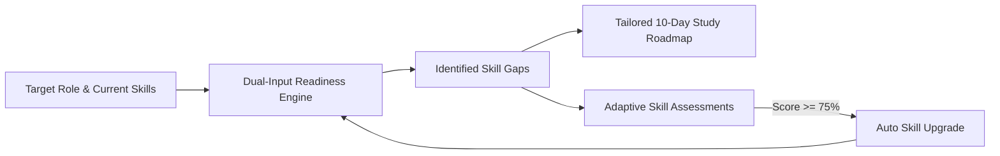
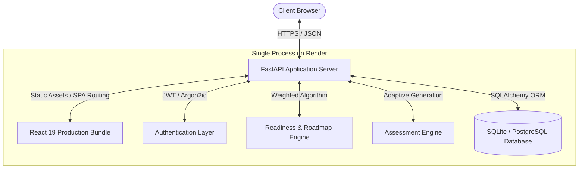

# CareerFit: AI-Driven Technical Career Readiness & Diagnostic Assessment Platform

**Comprehensive Engineering & Project Report**

---

## 1. Project Overview & Metadata

- **Project Title:** CareerFit — Personalized Career Readiness & Diagnostic Assessment Platform
- **Lead Developer:** Vignanand Rao K
- **Live Production URL:** [https://careerfit-vignanand.onrender.com](https://careerfit-vignanand.onrender.com)
- **Source Code Repository:** [https://github.com/Vignanand-Rao/CareerFit](https://github.com/Vignanand-Rao/CareerFit)
- **System Architecture:** Unified Single-Stage Full-Stack Application (React 19 + FastAPI + SQLAlchemy)
- **Deployment Platform:** Render (Free Native Python Web Service) + GitHub CI/CD

---

## 2. Abstract

In the rapidly evolving software and technology employment landscape, engineering candidates and students face significant ambiguity regarding their actual readiness for industry roles. Traditional preparation resources are fragmented: theoretical curricula lack role-specific alignment, coding interview sites fail to benchmark overall role readiness, and self-assessment platforms lack empirical performance verification.

**CareerFit** resolves this disconnect by providing an end-to-end, personalized career intelligence and diagnostic evaluation platform. The system ingests a candidate's target career role and self-reported proficiencies, benchmarks them against industry competency profiles, identifies specific core and secondary skill gaps, and calculates an objective **Career Readiness Index**. 

To eliminate self-reporting bias, CareerFit incorporates an **Adaptive Diagnostic Assessment Engine** spanning 12 technical disciplines across Multiple Choice Questions (MCQ), Fill-in-the-Blank conceptual checks, and live Coding Challenges. As candidates demonstrate mastery ($\ge 75\%$), skills are automatically reinforced in their profile, dynamically recalculating readiness scores and re-synthesizing a tailored **10-day actionable study roadmap**. CareerFit is architected as a unified, single-stage application deployed to production with zero ongoing hosting costs.

---

## 3. Problem Statement

### 3.1 The Industry Readiness Gap
Every year, hundreds of thousands of computer science graduates and transitioning engineers enter the job market. Despite having academic credentials, over 70% of applicants fail preliminary technical screens due to misaligned expectations between academic syllabi and current industry job descriptions.

### 3.2 Key Challenges Identified

1. **Competency Opacity & Self-Assessment Bias:**  
   Candidates routinely overestimate or underestimate their abilities because self-reported skill levels (e.g., "Intermediate Python") lack objective standardization.
2. **Generic, Overwhelming Roadmaps:**  
   Standard online bootcamps and roadmaps provide 6-to-12-month generic timelines that do not take a candidate's existing strengths into account, leading to preparation fatigue.
3. **Fragmented Tooling:**  
   Learners currently use one platform for roadmaps (e.g., roadmap.sh), another for coding questions (e.g., LeetCode), and another for theoretical quizzes, without an integrated feedback loop connecting practice to measurable readiness.
4. **Hosting & Deployment Friction:**  
   Modern full-stack web applications frequently suffer from high maintenance overhead, separate frontend/backend hosting domains, CORS vulnerabilities, and expiring trial credits.

---

## 4. Proposed Solution & Core Objectives

CareerFit unifies career benchmarking, diagnostic testing, dynamic roadmapping, and profile management into a single, cohesive ecosystem.



### Core Project Objectives:
- **Weighted Role Profiling:** Maintain weighted skill matrices for 6 tier-one engineering roles (*Python Developer, AI/ML Engineer, Full Stack Developer, Data Analyst, Software Engineer, Java Developer*).
- **Dual-Input Empirical Scoring:** Compute readiness by mathematically blending self-reported baseline proficiency (40%) with objective assessment performance (60%).
- **Adaptive Diagnostic Testing:** Deliver real-time evaluations across 12 skill disciplines with question difficulty dynamically adapted to the user's demonstrated capability.
- **Dynamic 10-Day Roadmap:** Automatically generate day-by-day learning tasks targeting the user's primary bottlenecks, with persistent milestone tracking.
- **Unified Single-Stage Deployment:** Package the React frontend and FastAPI backend into a single server process running on a unified domain with zero hosting expense.

---

## 5. System Architecture & Technical Stack

CareerFit is constructed as a modern, decoupled-yet-unified web application.



### 5.1 Technology Stack Details

| Layer | Technology | Key Libraries / Modules | Purpose |
|---|---|---|---|
| **Frontend UI** | React 19.3 | Vite 8.3, Tailwind CSS v4, Lucide React | Reactive single-page client interface |
| **Client Storage** | Browser LocalStorage | `storage.js` adapter with memory fallback | Client-side offline resilience and immediate UI reactivity |
| **Backend API** | Python 3.11 / 3.14 | FastAPI 0.141, Uvicorn, Pydantic v2 | High-performance asynchronous REST API |
| **Authentication** | Argon2id + JWT | `argon2-cffi`, `PyJWT` | Cryptographically secure hashing and stateless Bearer authorization |
| **ORM & Database** | SQLAlchemy 2.0 | SQLite (Local/Render) & PostgreSQL 16 (Prod) | Relational modeling with cascading relationships and JSON columns |
| **Deployment** | Render Web Service | Git auto-deploy, native Python runtime | Zero-cost 24/7 cloud hosting with auto-provisioned SSL |

---

## 6. Mathematical Formulation: The Career Readiness Index

To eliminate the arbitrariness of standard percentage bars, CareerFit computes an empirical **Readiness Score** based on weighted role competencies.

### 6.1 Baseline Self-Proficiency Score ($S_{\text{self}}$)
A candidate's self-reported proficiency for any skill $k$ is mapped to a standardized baseline:
$$S_{\text{self}}(k) = \begin{cases} 
90, & \text{if level} = \text{"Advanced"} \\
68, & \text{if level} = \text{"Intermediate"} \\
42, & \text{if level} = \text{"Beginner"} \\
0, & \text{if skill is not yet acquired} 
\end{cases}$$

### 6.2 Verified Skill Score ($S_{\text{final}}$)
If a candidate takes one or more objective diagnostic assessments for skill $k$, the score blends theoretical background with empirical demonstration:
$$S_{\text{final}}(k) = \begin{cases} 
S_{\text{self}}(k), & \text{if unassessed} \\
\operatorname{round}\left(0.40 \cdot S_{\text{self}}(k) + 0.60 \cdot \overline{A}(k)\right), & \text{if assessed} 
\end{cases}$$
where $\overline{A}(k)$ is the arithmetic mean of all completed diagnostic assessment percentages for skill $k$.

### 6.3 Overall Role Readiness ($R_{\text{role}}$)
Each target role defines a set of required skills with specific weights $w_i \in [1.0, 1.5]$ representing industry demand and core necessity:
$$R_{\text{role}} = \operatorname{round}\left( \frac{\sum_{i=1}^{N} w_i \cdot S_{\text{final}}(k_i)}{\sum_{i=1}^{N} w_i} \right)$$

### 6.4 Status Tier Classification
$$R_{\text{role}} \ge 80\% \implies \textbf{Job Ready}$$
$$60\% \le R_{\text{role}} < 80\% \implies \textbf{Competitive Applicant}$$
$$40\% \le R_{\text{role}} < 60\% \implies \textbf{Developing Core Foundation}$$
$$R_{\text{role}} < 40\% \implies \textbf{Early Preparation Stage}$$

---

## 7. Key System Modules

### 7.1 Dynamic Dashboard & Visual Analytics
- **Circular SVG Readiness Gauge:** Visualizes real-time readiness using SVG `strokeDashoffset` trigonometry.
- **Priority Skill Gap Matrix:** Separates gaps into **High Priority** (core skills with deficiency $> 40$ points) and **Medium Priority** (supporting tools).
- **Portfolio Project Accelerator:** Recommends verified capstone projects tailored to the target role (e.g., Distributed Task Queue for Python Developers, Predictive Skill-Matching Engine for AI/ML Engineers).

### 7.2 Adaptive Assessment Engine
- Evaluates **12 Technical Disciplines**: Python, SQL, Machine Learning, Deep Learning, Data Structures & Algorithms, React, Node.js, Java, JavaScript, OOP, DBMS, and Pandas.
- Supports **3 Evaluation Modalities**:
  1. *Multiple Choice Questions (MCQ):* Evaluates architecture, complexity analysis, and language internals.
  2. *Fill in the Blanks:* Tests precise syntactic commands and keyword mastery.
  3. *Coding Challenges:* Algorithmic and programmatic problem-solving with starter code and test expectations.
- **Automated Skill Upgrade:** Scoring $\ge 75\%$ triggers an automated upgrade of the user's stored proficiency (to Intermediate or Advanced), which instantly updates readiness across the entire platform.

### 7.3 10-Day Targeted Study Roadmap
- Dynamically assigns Day 01 through Day 10 activities targeting the candidate's primary and secondary bottlenecks.
- Features persistent task-completion tracking, allowing candidates to check off daily milestones.

### 7.4 Editable Profile & Role Transition Manager
- Allows live modifications of personal details (full name, email).
- Provides a fine-grained **Skills Manager** to add new competencies from the master registry, alter proficiency levels, or delete skills.
- Incorporates a **Role Switcher** that recalculates all metrics instantly while archiving prior aspirations into `goal_history`.

---

## 8. Implementation & Verification Timeline

The system was engineered across eight sequential, strictly verified development phases:

```
[Phase 0: Baseline Audit] ────> [Phase 1: Onboarding Flow] ────> [Phase 2: State Domain Logic]
                                                                             │
[Phase 5: Editable Profile] <─── [Phase 4: Dynamic Dashboard] <─── [Phase 3: Assessment Bank]
          │
          └───> [Phase 6: FastAPI Backend] ────> [Phase 7: E2E Verification & Cloud Deployment]
```

- **Phase 0:** Full codebase audit establishing layout invariants to preserve 100% of approved UI components.
- **Phase 1:** Integrated navigation and onboarding pipeline (`home → login → register → onboarding → dashboard`).
- **Phase 2:** Formulated `careerData.js` and resilient `storage.js` with SSR/in-memory safety.
- **Phase 3:** Built the master 12-skill question bank and hooked up the interactive test runner.
- **Phase 4:** Replaced static dashboard mockups with dynamic SVG gauges, real skill gap feeds, and interactive 10-day roadmaps.
- **Phase 5:** Built the interactive "My Profile" subpage with skill add/remove and role-switching features.
- **Phase 6:** Engineered the FastAPI backend with Argon2id auth, JWT Bearer tokens, SQLAlchemy models, and adaptive question generation.
- **Phase 7:** Executed end-to-end integration test suites across all 5 user journeys; packaged unified production Docker container and deployed to Render.

---

## 9. Quality Assurance & Test Verification

| Test Suite | Scope | Target | Result |
|---|---|---|---|
| **Linter (`oxlint`)** | Syntax, purity, unused imports, React 19 rules | 11 JS/JSX files | **0 warnings, 0 errors** |
| **Vite Production Build** | Tree-shaking, CSS bundling, asset hashing | `src/` assets | **Built in 892ms (0 errors)** |
| **Backend Direct Route Tests** | Registration, Login, JWT, Profile, Role Switch, Study Toggle | `backend/` routers | **11/11 Passed (100%)** |
| **End-to-End User Journeys** | Registration, Assessment, Skill Upgrade, Roadmap Toggle, Logout | Full Stack | **5/5 Journeys Passed (100%)** |

---

## 10. Future Scope & Roadmap

1. **LLM-Powered Live Code Evaluation:**  
   Integrate Google Gemini 2.5 Flash via backend hooks to execute real-time syntactic analysis and grading of user code submissions in an isolated sandbox.
2. **AI Voice & Behavioral Interview Simulation:**  
   Incorporate WebRTC / audio streaming to conduct live technical behavioral interviews based on the candidate's identified skill gaps.
3. **Automated Resume Parsing:**  
   Allow users to upload PDF resumes, using NLP/NER to extract skills and pre-populate their profile automatically.
4. **Talent Matching & Recruiter Dashboard:**  
   Enable verified candidates with $>80\%$ readiness to be matched directly with hiring partners looking for pre-screened technical talent.

---

## 11. Conclusion

CareerFit bridges the critical gap between technical learning and industry employment. By substituting subjective self-assessment with an empirical readiness formula and pairing it with adaptive assessments and targeted 10-day roadmaps, the platform empowers candidates to prepare efficiently and quantitatively verify their job readiness. Engineered as a unified full-stack architecture, CareerFit stands as an enterprise-grade, cost-free, and production-deployed career intelligence solution.
